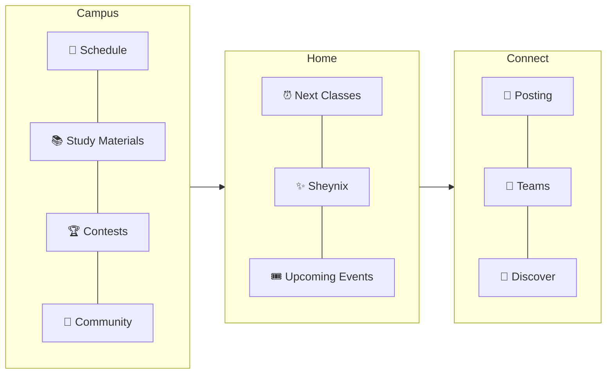
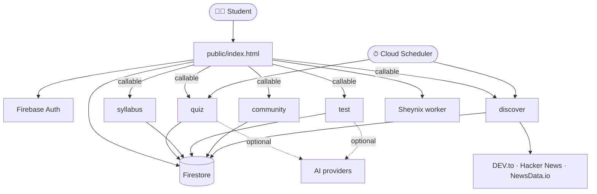

<div align="center">



<br/>

[](https://cse-c-hub.web.app)
[](../LICENSE)
[](https://firebase.google.com)
[](#-backend-codebases)
[](public/index.html)

**The Campus Loop web app and every backend service behind it.**

[⬅ Platform overview](../README.md) &nbsp;·&nbsp; [📱 Android app](../CL-app/README.md)


</div>

## 📖 Overview

`CL-web` is the home of the Campus Loop **web app** and its **serverless backend**. The entire front end lives in a single self-contained file — [`public/index.html`](public/index.html) (≈17k lines, vanilla JS, no build step) — and talks to Firebase directly plus five Cloud Functions codebases for anything that must be trusted.

| | |
|---|---|
| **Firebase project** | `cse-c-hub` |
| **Hosting** | <https://cse-c-hub.web.app> |
| **Front end** | One `index.html`, Firebase JS SDK 10.14.1 (compat), no bundler |
| **Backend** | 5 Cloud Functions codebases · Firestore rules + indexes · Cloud Scheduler jobs |
| **Auth** | Email/Password · Google · Anonymous (Guest) · custom claims for `owner` |

<div align="center"></div>

## ✨ Features

### Sections



| Section | What you get |
|---|---|
| 📅 **Schedule** | Timetable · Event Calendar (academic events first) · Tasks + **My Calendar** · Attendance (subject stats, log previous attendance, extra & substitute classes, settings) |
| 📚 **Study Materials** | Subject cards from your timetable · browse / favourites / recently accessed · important notes · **P-cycle / C-cycle** switch for first-years |
| 🏆 **Contests** | **Daily Quiz** · **Tests** from uploaded papers · **Leaderboards** (daily / weekly / overall) · **Total XP** |
| 💬 **Community** | Year-locked chats + common chat · LinkLearn · Exam Q&A · reactions, typing, reports, warnings, restrictions |
| ⏰ **Home** | Next Classes from your timetable · **Sheynix** companion card · next three Upcoming Events |
| 🧭 **Connect** | **Discover** (Articles + Events) is live · **Posting**, **Teams** & **Events** are a UI preview using in-memory sample data |
| ⚙️ **Settings & About** | Academic profile, appearance (Default / Blaze / Aqua · Light / Dark), notifications, backup & restore, logout |

### Highlights

- ✨ **Sheynix** — a living 3D mascot with an AI chat sheet, themed to Default / Blaze / Aqua.
- 🔐 **Three ways in** — Email, Google, or Guest. A guest who registers or links Google **keeps the same account and progress**.
- ☁️ **Cross-device sync** — attendance, tasks, notes, favourites, theme and more sync per user (`userData/{uid}/items/{key}`), plus JSON **backup & restore**.
- 🧭 **First-run onboarding** — profile (name / year / branch / section / batch) and a guided tour.
- 🔔 **Notifications** — in-app centre; on Android also class reminders and FCM pushes.
- 🧑‍🏫 **Role dashboards** — CR, Admin and Owner tooling for resources, quizzes, announcements and moderation.

<div align="center"></div>

## 🏗️ Architecture



### ☁️ Backend codebases

All five are declared in [`firebase.json`](firebase.json).

| Codebase | Folder | Responsibilities |
|---|---|---|
| `quiz` | [`functions-quiz/`](functions-quiz) | Year-specific Daily Quiz: start / submit / review, stats, leaderboards, AI question generation, admin (generate, edit, publish, finalize, correct, delete, settings), daily rollover, evening & last-call reminders, morning results |
| `syllabus` | [`functions-syllabus/`](functions-syllabus) | Total-XP summary (`xpGetSummary`), de-duplicated XP ledger |
| `test` | [`functions-test/`](functions-test) | Upload → extract questions from **PDF / DOCX / TXT** (AI or rule-based fallback) → start / submit / score, per-student results, reset attempts, publish / delete |
| `community` | [`functions-community/`](functions-community) | Chat moderation and message reports |
| `discover` | [`functions-discover/`](functions-discover) | News ingestion & normalisation, daily refresh, anonymous comments, reporting & moderation |

### 🏅 XP rules

- Per unit test: `10 + round(percentage × 40 / 100)` (0 if nothing was answered).
- A unit pays at most its **best-ever** XP; a better retake adds only the improvement.
- **Total XP** = Test XP + Daily Quiz XP. The browser never calculates or writes XP.
- Tunable at runtime through Firestore `syllabusConfig/settings.xp`.

### 🧭 Discover

- The **backend** fetches, normalises and de-duplicates articles (document id = hash of the cleaned URL); browsers never call news APIs.
- Auto-refresh: `discoverDailyRefresh` at **05:30 IST**, `discoverEnsureFresh` every **6 h**; manual refresh uses one global lock with a cool-down.
- Comments are **anonymous** publicly; posting is rate-limited (5/min, 40/h), spam-checked, and three different reporters auto-hide a comment.

<div align="center"></div>

## 🚀 Getting started

### Prerequisites

- **Node.js 22** and the Firebase CLI: `npm i -g firebase-tools`
- A Firebase project on the **Blaze** plan
- **Authentication** → enable **Anonymous**, **Email/Password** and **Google**; add your hosting domains under *Authorized domains*
- **Firestore** created; your web config placed in `FIREBASE_CONFIG` inside `public/index.html`

### Secrets (Firebase Secret Manager)

| Secret | Used by | Notes |
|---|---|---|
| `QUIZ_AI_API_KEY` | `quiz`, `test` | Optional AI generation / extraction. Without it, the rule-based extractor is used |
| `NEWSDATA_API_KEY` | `discover` | Free key from newsdata.io — set to `none` to run on DEV.to + Hacker News only |

```bash
firebase functions:secrets:set QUIZ_AI_API_KEY
firebase functions:secrets:set NEWSDATA_API_KEY
```

### Install & validate (deploys nothing)

```bash
(cd functions-quiz      && npm ci)
(cd functions-syllabus  && npm ci)
(cd functions-test      && npm ci)
(cd functions-community && npm ci)
(cd functions-discover  && npm ci)

bash scripts/check-all.sh   # JSON · JS syntax (functions + inline page scripts) · unit tests
```

### Deploy

Order matters — **rules and indexes first, then functions, then hosting.**

```bash
firebase deploy --only firestore:rules,firestore:indexes
firebase deploy --only functions
firebase deploy --only hosting
```

> Index builds take a few minutes; until they finish, leaderboards and Discover show an index error — just retry.

### Local preview

```bash
firebase emulators:start --only hosting
# or simply serve ./public with any static server
```

<div align="center"></div>

## 🔒 Security model

| Area | Rule |
|---|---|
| **XP & leaderboards** | Client writes denied; Cloud Functions only |
| **Leaderboards** | Students read only their **own academic year**; owner can read all |
| **Discover** | Articles, authors, reports are server-only; comments anonymous in the public doc |
| **Roles** | `owner` is a Firebase **custom claim**; CR accounts are invite-based |
| **Secrets** | Firebase Secret Manager; `.env*`, service accounts and `.release-keys/` are git-ignored |

The source of truth is [`firestore.rules`](firestore.rules); composite indexes and TTL overrides live in [`firestore.indexes.json`](firestore.indexes.json).

## 📦 Shipping to the Android app

The same `public/index.html` powers the Android app. A signed release pipeline in [`tools/release/`](tools/release) builds, verifies and publishes over-the-air updates:

```bash
node tools/release/release.mjs init  --android ../CL-app   # once: create signing key, embed PUBLIC key in the app
node tools/release/release.mjs build   1.0.3               # build + verify the ZIP locally
node tools/release/release.mjs publish 1.0.3               # deploy ZIP, verify it live, then sign + deploy version.json
node tools/release/release.mjs rollback 1.0.2              # point every device at an older release
node tools/release/release.mjs verify                      # inspect what is live right now
```

Published releases live in `public/app-releases/` and are described by `public/version.json` (served with `no-cache`). See [CL-app](../CL-app/README.md) for how devices consume them.

## 🧪 Testing

| Suite | Command |
|---|---|
| Everything offline | `bash scripts/check-all.sh` |
| Discover | `cd functions-discover && npm test` |
| Syllabus / XP | `cd functions-syllabus && npm test` |
| Test backend (incl. real PDF/DOCX round-trips) | `cd functions-test && npm test` |
| Community | `cd functions-community && npm test` |
| Quiz-year scenarios | see [`tests-quiz-year/`](tests-quiz-year) |
| Account flows | [`scripts/account-tests/`](scripts/account-tests) |

CI: **GitHub Actions** deploy to Firebase Hosting on merge, and create preview channels on pull requests (see [`.github/workflows/`](.github/workflows)).

## 🗂️ Folder map

```text
CL-web/
├── public/
│   ├── index.html              ← the whole front end
│   ├── version.json            ← signed OTA manifest
│   ├── app-releases/           ← 1.0.0 · 1.0.1 · 1.0.2 …
│   └── docs/                   ← academic calendar PDF
├── functions-quiz/  functions-syllabus/  functions-test/
├── functions-community/  functions-discover/
├── firestore.rules  firestore.indexes.json  firebase.json
├── tools/release/  tools/aiml-import/  tools/ise-import/
├── scripts/                    ← check-all.sh · XP back-fills · account tests
├── tests-quiz-year/
└── API-CONTRACT.md  ACCOUNTS-SYNC.md  STUDENT-CENTRO-UPDATE.md
```

Deeper docs: [`API-CONTRACT.md`](API-CONTRACT.md) · [`ACCOUNTS-SYNC.md`](ACCOUNTS-SYNC.md) · [`STUDENT-CENTRO-UPDATE.md`](STUDENT-CENTRO-UPDATE.md) · [`functions-test/README.md`](functions-test/README.md) · [`functions-community/README.md`](functions-community/README.md)

## 🛠️ Troubleshooting

| Symptom | Fix |
|---|---|
| "Discover service is not reachable" | Deploy `functions:discover` first |
| Leaderboard asks for an academic year | Re-select your year in **Settings → Academic profile** |
| Index error on leaderboards / Discover | Wait for index build to finish, then retry |
| Google sign-in blocked on Android | Expected inside WebViews — the app uses native Google sign-in instead |

## 📄 License

[MIT](../LICENSE) © 2026 Campus Loop Contributors

<div align="center">
<br/>

[⬅ Back to platform overview](../README.md) &nbsp;·&nbsp; [⬆ Back to top](#-overview)

</div>
