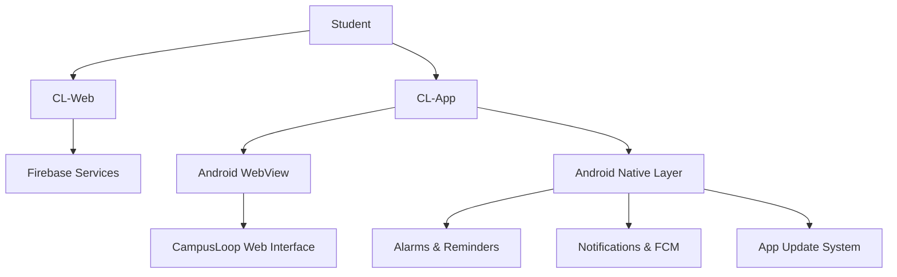

[README.md](https://github.com/user-attachments/files/34617647/README.md)

# ∞ CampusLoop

### Campus · Connect · Grow

**One connected student ecosystem for academics, community, and personal growth.**

[Open CampusLoop](csehub.site)

---

## 🌟 What is CampusLoop?

**CampusLoop** is a student-focused platform that brings essential campus tools and student experiences into one connected environment. It is made up of two complementary products:

- **CL-Web** — the web platform, academic workspace, and community/discovery experience.
- **CL-App** — the Android companion that embeds the web experience and adds native mobile capabilities such as reminders, notifications, and app update support.

Together, they aim to make academic organization, learning, collaboration, and campus connection easier to access.

## 🧩 The CampusLoop ecosystem

| Product | Purpose | Highlights |
|---|---|---|
| **CL-Web** | Main web platform | Campus tools, Home, Connect, Discover, chat, quizzes, tests, XP, admin tools |
| **CL-App** | Android companion | WebView app, native reminders, notifications, FCM integration, update infrastructure |

## 🏫 Campus — Academic tools

- **Timetable & schedule:** keep class schedules and academic routines accessible.
- **Attendance:** attendance tracking and related student information.
- **Study materials:** subject-wise resources and links, including first-year cycle-specific organization.
- **Daily Quiz:** daily practice, scoring, and academic-year leaderboards.
- **Syllabus Test:** practice assessments, server-side scoring, review, and results.
- **XP & progress:** academic engagement points and progress/leaderboard experiences.
- **Themes & responsive UI:** personalize the interface and use it across screen sizes.

## 🤝 Connect — Student community

- **Discover:** a feed of technology and learning content from supported publishers.
- **Study Chat & LinkLearn:** separate community spaces for conversation and learning.
- **Find People / Find Teams / Events:** areas for networking and collaboration.
- **Community safety:** reporting, admin moderation, warnings, and chat restrictions.
- **Campus communication:** role-aware announcements and student communication features where enabled.

## 🌱 Grow — Future-facing expansion

CampusLoop is designed to expand beyond academic utilities. Grow represents the platform's broader personal-development direction and can be developed into additional learning, career, skills, and growth experiences over time.

## 🧠 Shared platform capabilities

- Firebase-backed authentication and data services.
- Cloud Functions for trusted server-side operations.
- Student profiles and academic context.
- Server-managed quiz/test results and XP.
- Admin/owner workflows and moderation tools.
- Responsive web experience with Android integration.

## 🏗️ How the products work together

- The **web platform** provides the core student experience and Firebase-backed functionality.
- The **Android app** displays the CampusLoop web interface through WebView.
- The Android native layer complements the website with mobile-specific capabilities.
- Firebase services support authentication, data, backend operations, and configured push workflows.

## 🛠️ Technology overview

| Area | Technologies |
|---|---|
| Web frontend | HTML, CSS, JavaScript |
| Android | Kotlin, Android SDK, WebView |
| Backend | Firebase Cloud Functions, Node.js |
| Data | Cloud Firestore, Firebase Storage (where used) |
| Authentication | Firebase Authentication |
| Web deployment | Firebase Hosting |
| Android build | Gradle, Android Studio |
| Push | Firebase Cloud Messaging + Android notifications |

## 📦 Repositories & documentation

If the projects are maintained separately, use their dedicated repositories and README files:

- **CL-Web:** web frontend, Firebase configuration, rules, indexes, and Cloud Functions.
- **CL-App:** Android Studio project, native Kotlin modules, WebView integration, and app update/notification code.

> Add the actual GitHub repository URLs here when publishing this overview README.

## 🔒 Security & deployment notes

- Firebase rules and server-side functions are part of the security boundary.
- Never commit service-account keys, private signing keys, or production secrets.
- Use your own Firebase configuration when setting up a development environment.
- Android notifications, alarms, and updates require correct permissions and release configuration.
- Deploy backend changes and Firestore rules deliberately; frontend-only changes may still depend on backend compatibility.

## 🧭 Project direction

CampusLoop's broader vision is to connect three student needs:

- **Campus:** stay organized and academically prepared.
- **Connect:** discover people, resources, and opportunities.
- **Grow:** develop skills and move forward beyond the classroom.

## 👋 Contributing & feedback

Issues, ideas, and improvements can be documented through the issue tracker of the relevant repository. When contributing, include a clear description, testing notes, and any Firebase/Android setup requirements.

## 📄 License

A license has not been specified in this README. Add a `LICENSE` file before inviting external contributions or distributing code under open-source terms.

### **CampusLoop**

*Campus. Connect. Grow.*

