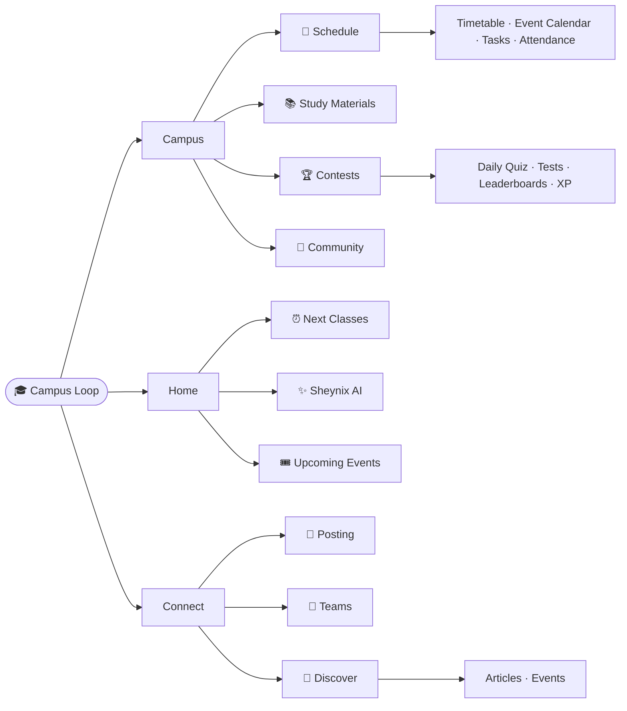
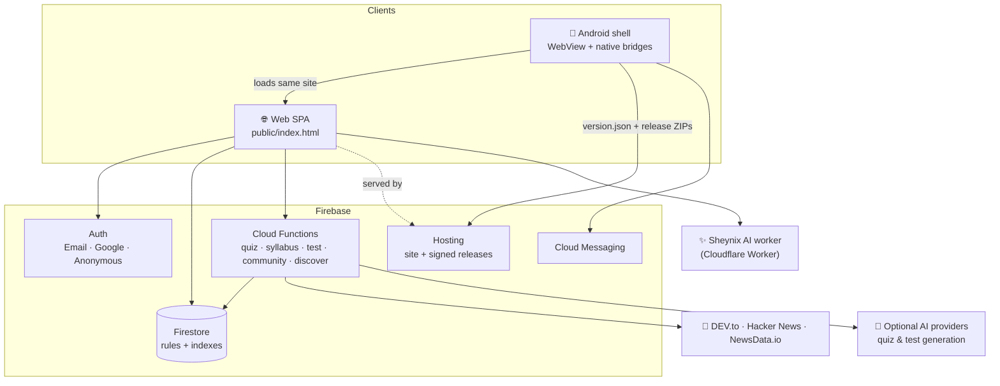

<div align="center">



<br/>

[](LICENSE)
[](https://cse-c-hub.web.app)
[](CL-app)
[](CL-web)
[](CL-web/functions-quiz)
[](#-contributing)

### Your timetable, study material, contests, community and campus news — in one loop.

**[🌐 Open the web app](https://cse-c-hub.web.app)** &nbsp;·&nbsp; **[📱 Android app](CL-app)** &nbsp;·&nbsp; **[🧩 Web & backend](CL-web)** &nbsp;·&nbsp; **[🐛 Report a bug](https://github.com/ShwethaG-MAX/SASH_1.0/issues)**


</div>

## ✨ What is Campus Loop?

**Campus Loop** is a student platform built around the daily rhythm of college life. It answers the questions students actually ask every day: *What's my next class? Am I short on attendance? What should I revise? How did I rank in today's quiz? What's happening on campus?*

It ships as **one codebase, three deliverables**:

| | Part | What it is | Folder |
|---|---|---|---|
| 🌐 | **Campus Loop Web** | A fast single-page app (`public/index.html`) on Firebase Hosting | [`CL-web/`](CL-web) |
| 📱 | **Campus Loop App** | A native Android shell that runs the same site **offline-first** and updates itself over the air | [`CL-app/`](CL-app) |
| ☁️ | **Campus Loop Backend** | Five Firebase Cloud Functions codebases + Firestore rules/indexes that do all the trusted work (scoring, XP, moderation, news ingestion) | [`CL-web/functions-*`](CL-web) |

<div align="center"></div>

## 🧭 Feature tour

Campus Loop is organised into three top-level sections — **Campus · Home · Connect** — with a theme-aware, mobile-first UI.



<table>
<tr>
<td width="50%" valign="top">

### 📅 Schedule
- **Timetable** with a "next classes" view
- **Event Calendar** — academic calendar events first
- **Tasks** with **My Calendar** and daily notes
- **Attendance tracker** — per-subject stats, log previous attendance, extra classes, substitute classes, configurable settings
- **Class reminders** on Android, even when the app is closed

</td>
<td width="50%" valign="top">

### 📚 Study Materials
- Subject cards built from your timetable
- **Browse all resources**, favourites, recently accessed, important notes
- **First-year P-cycle / C-cycle** switch with per-cycle subject links
- Share, edit and organise resources (CR / admin tools)
- Branch, year and section aware (CSE, CSBS, AIML, ISE and more)

</td>
</tr>
<tr>
<td valign="top">

### 🏆 Contests
- **Daily Quiz** — year-specific, AI-assisted generation, review with explanations
- **Tests** — upload a question paper (PDF / DOCX / TXT), get a ready-to-take test
- **Leaderboards** — daily, weekly and overall, scoped to your academic year
- **Total XP** — server-calculated, de-duplicated, best-attempt-wins

</td>
<td valign="top">

### 💬 Community
- Year-locked community chats plus a common chat
- **LinkLearn** and **Exam Q&A** spaces
- Reactions, typing indicators, replies
- Reporting, warnings, restrictions and a moderation log
- Announcements from owner / admin / CR

</td>
</tr>
<tr>
<td valign="top">

### ✨ Sheynix — your study companion
- A **living 3D avatar** on Home with a one-tap **Talk to Sheynix** chat
- Ask about classes, tasks, calendar or attendance
- Three personalities that follow your theme: **Default · Blaze · Aqua**

</td>
<td valign="top">

### 🧭 Connect
- **Discover** — daily-refreshed tech news (DEV.to, Hacker News, NewsData.io) with interest filters, bookmarks and anonymous, moderated comments
- **Posting**, **Teams** and **Events** — campus feed, people & team finder, hackathons / workshops / fests *(UI preview with sample data today)*

</td>
</tr>
</table>

### 🎨 Look & feel
**Default · Blaze · Aqua** themes × **Light · Dark** modes, a quick theme switcher in the header, a first-time onboarding tour, and a total-XP chip that's always one tap away.

### 🔐 Accounts & roles
| Role | How they get in | What they can do |
|---|---|---|
| 🎒 **Student** | Email, Google, or Guest | Everything in the student experience; progress syncs across devices |
| 👤 **Guest → Student** | Register / link Google later | Keeps the *same* account and all progress when upgrading |
| 🧑‍🏫 **CR** | CR account via invite | Manage class resources and announcements |
| 🛡️ **Admin** | Admin login | Quiz management, moderation, reports, resource tools |
| 👑 **Owner** | `owner` custom claim | Full admin dashboard across years |

<div align="center"></div>

## 🏗️ Architecture



**Design principles**

- **Trusted work stays on the server.** The browser never calculates or writes XP, leaderboards or moderation state — Firestore rules deny it and Cloud Functions do it.
- **One site, two homes.** The Android app embeds the exact same `index.html`, so a feature ships to web and mobile at once.
- **Offline-first on Android.** The site is bundled in the APK, then updated in the background via cryptographically signed releases (see [CL-app](CL-app)).
- **Privacy-minded community.** Discover comments are anonymous in the public document; the author link lives in server-only collections.

<div align="center"></div>

## 🗂️ Repository layout

```text
SASH_1.0/
├── assets/                     ← README banners (SVG)
├── CL-web/                     ← 🌐 Web app + ☁️ backend
│   ├── public/                 ·  index.html, version.json, app-releases/, docs/
│   ├── functions-quiz/         ·  Daily Quiz, leaderboards, AI generation, reminders
│   ├── functions-syllabus/     ·  Total XP aggregation & XP ledger
│   ├── functions-test/         ·  Test upload → extract → take → score
│   ├── functions-community/    ·  Chat moderation & reports
│   ├── functions-discover/     ·  News ingestion, comments, moderation
│   ├── firestore.rules         ·  Security rules
│   ├── firestore.indexes.json  ·  Composite indexes + TTLs
│   ├── tools/release/          ·  Signed OTA release tool
│   ├── scripts/                ·  check-all.sh, XP back-fills, account tests
│   └── .github/workflows/      ·  Firebase Hosting CI
└── CL-app/                     ← 📱 Android (Kotlin) shell
    └── app/src/main/
        ├── java/com/study/csehub/        ·  MainActivity, reminders, push, bridges
        ├── java/com/study/csehub/update/ ·  Offline-first OTA update engine
        └── assets/                       ·  Bundled site + Firebase SDK
```

<div align="center"></div>

## 🚀 Quick start

```bash
git clone https://github.com/ShwethaG-MAX/SASH_1.0.git
cd SASH_1.0
```

| I want to… | Go to |
|---|---|
| Run / deploy the **web app & backend** | [`CL-web/README.md`](CL-web/README.md) |
| Build the **Android app** or ship an OTA update | [`CL-app/README.md`](CL-app/README.md) |

**30-second web validation (no Firebase credentials needed):**

```bash
cd CL-web
(cd functions-syllabus && npm ci) && (cd functions-discover && npm ci)
bash scripts/check-all.sh
```

## 🧰 Tech stack

| Layer | Technology |
|---|---|
| Front end | Vanilla JavaScript, HTML & CSS in a single-file SPA; Firebase JS SDK 10.14.1 (compat) |
| Backend | Firebase Cloud Functions (Node.js 22), Firestore, Auth, Hosting, Cloud Messaging, Cloud Scheduler |
| Android | Kotlin, WebView + `WebViewAssetLoader`, WorkManager, Credential Manager (Google sign-in), FCM, AlarmManager |
| AI | Sheynix chat via a Cloudflare Worker; optional Anthropic / OpenAI / Groq / Gemini for quiz & test generation |
| Content | DEV.to, Hacker News, NewsData.io |
| CI/CD | GitHub Actions → Firebase Hosting; signed release ZIPs for Android |

## 🛡️ Security highlights

- 🔏 **Signed OTA releases** — ECDSA P-256 / SHA-256 manifest signature, host allow-list, per-file SHA-256, zip-bomb limits, atomic install and **automatic rollback**.
- 🧱 **Deny-by-default Firestore rules** — clients cannot write XP, leaderboards, articles or moderation state.
- 🚦 **Rate-limited & spam-checked** community and comment endpoints.
- 🔑 **Secrets in Secret Manager** (`QUIZ_AI_API_KEY`, `NEWSDATA_API_KEY`) — never in the repo.

> **Never commit** `CL-web/.release-keys/release-private.pem` or any service-account JSON. The provided `.gitignore` already excludes them.

## 🤝 Contributing

Contributions are welcome!

1. Fork the repo and create a branch: `git checkout -b feat/amazing-idea`
2. Make your change and run `bash CL-web/scripts/check-all.sh`
3. Commit with a clear message and open a Pull Request

Found a bug or have an idea? [Open an issue](https://github.com/ShwethaG-MAX/SASH_1.0/issues).

## 📄 License

Released under the **[MIT License](LICENSE)** — free to use, modify and distribute with attribution.

<div align="center">
<br/>

**Built with ❤️ for students, by students.**

[⬆ Back to top](#-what-is-campus-loop)

</div>
